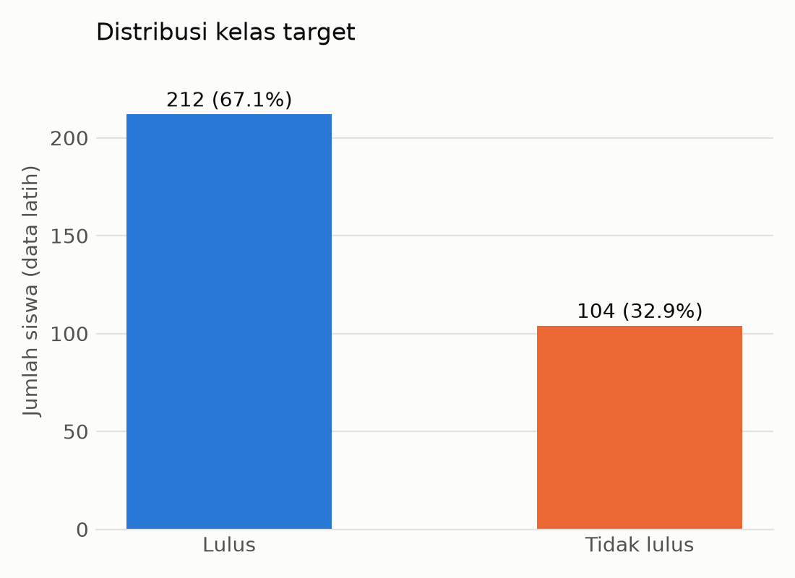
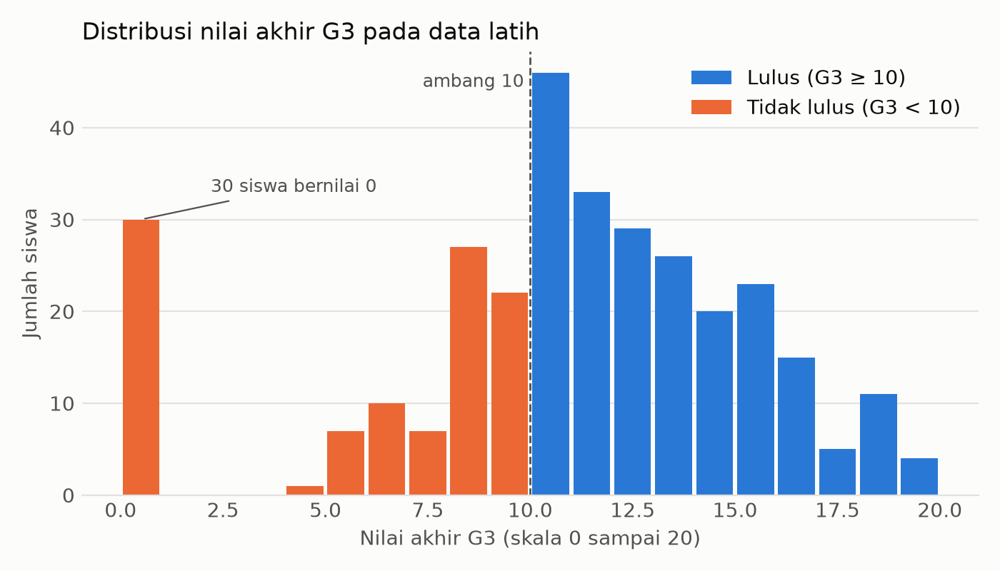
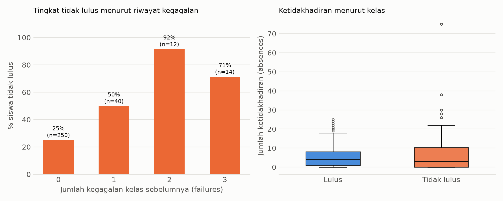
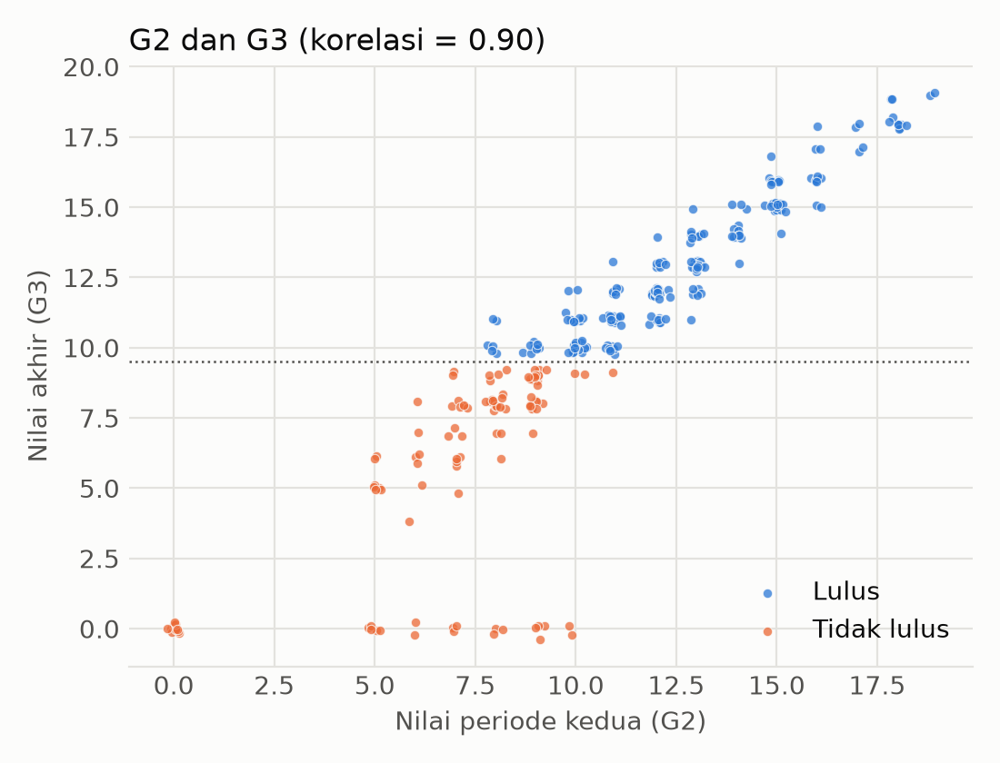

# Bab 2. Data

## 2.1 Sumber data

Data yang dipakai adalah dataset *Student Performance* dari UCI Machine Learning Repository (Cortez dan Silva, 2008). Data berisi catatan siswa sekolah menengah di dua sekolah di Portugal (Gabriel Pereira dan Mousinho da Silveira), yang dikumpulkan dari laporan sekolah dan kuesioner selama tahun ajaran 2005–2006. Arsip dataset memuat dua berkas, yaitu mata pelajaran Matematika (`student-mat.csv`, 395 siswa) dan Bahasa Portugis (`student-por.csv`). Kami memakai **Matematika**.

- Sumber: UCI Machine Learning Repository, *Student Performance* (https://archive.ics.uci.edu/dataset/320/student+performance). Berkas diunduh dari https://archive.ics.uci.edu/ml/machine-learning-databases/00320/student.zip.
- Berkas dipisahkan titik koma. Arti tiap atribut ada di `student.txt` dalam arsip tersebut.

## 2.2 Ukuran dan kualitas data

Data dipisahkan **sebelum** analisis apa pun menjadi 80% data latih dan 20% data uji (`train_test_split`, `stratify` pada target, `random_state=42`). Hasilnya 316 baris data latih dan 79 baris data uji. Data uji disegel dan tidak dibuka sampai tahap evaluasi akhir, sehingga seluruh angka dan grafik di bab ini hanya berasal dari data latih.

| Pemeriksaan (data latih) | Hasil |
|---|---|
| Ukuran | 316 baris, 34 kolom (32 fitur, nilai akhir G3, dan target `tidak_lulus`) |
| Jenis fitur | 15 numerik (termasuk atribut ordinal berkode angka) dan 17 kategorik (teks) |
| Nilai hilang | 0 (dihitung dengan `isna().sum()`) |
| Baris duplikat | 0 (dihitung dengan `duplicated().sum()`) |

**Target.** Target `tidak_lulus` bernilai 1 jika nilai akhir G3 di bawah 10 dan 0 jika sebaliknya. Pada data latih terdapat **212 siswa lulus (67,1%)** dan **104 siswa tidak lulus (32,9%)**. Kelas tidak seimbang secara sedang. Jika sebuah model selalu menebak "lulus", akurasinya sudah 67,1% tanpa menangkap satu pun siswa berisiko. Karena itu akurasi tidak dipakai sebagai metrik utama; yang dipakai adalah F1, recall, precision, dan ROC-AUC untuk kelas tidak lulus.

**Tabel 2.1 Ringkasan beberapa variabel numerik (data latih)**

| Variabel | Rata-rata | Median | Minimum | Maksimum |
|---|---|---|---|---|
| age (usia) | 16,68 | 17 | 15 | 22 |
| absences (ketidakhadiran) | 5,70 | 4 | 0 | 75 |
| G1 (nilai periode 1) | 10,91 | 11 | 3 | 19 |
| G2 (nilai periode 2) | 10,71 | 11 | 0 | 19 |
| G3 (nilai akhir) | 10,43 | 11 | 0 | 19 |

Dari 316 siswa, 280 (88,6%) berasal dari sekolah GP dan 36 dari sekolah MS, sehingga data didominasi satu sekolah.

## 2.3 Deskripsi fitur

**Tabel 2.2 Atribut dataset** (diparafrasekan dari dokumentasi dataset; lengkapnya di `student.txt`)

| Kelompok | Atribut | Keterangan |
|---|---|---|
| Demografi dan keluarga | school, sex, age, address, famsize, Pstatus | Sekolah (GP atau MS), jenis kelamin, usia, tempat tinggal (kota atau desa), ukuran keluarga (≤ 3 atau > 3 orang), status tinggal orang tua (bersama atau terpisah). |
| | Medu, Fedu, Mjob, Fjob, guardian | Tingkat pendidikan ibu dan ayah (skala 0 sampai 4), pekerjaan ibu dan ayah, dan wali siswa. |
| Sekolah dan belajar | reason, traveltime, studytime, failures | Alasan memilih sekolah, waktu tempuh (1 sampai 4), waktu belajar mingguan (1 sampai 4), jumlah kegagalan kelas sebelumnya. |
| | schoolsup, famsup, paid, activities, nursery, higher, internet | Dukungan belajar dari sekolah dan keluarga, les berbayar, kegiatan ekstrakurikuler, mengikuti pendidikan pra-sekolah, keinginan melanjutkan ke pendidikan tinggi, akses internet di rumah (ya atau tidak). |
| Kehidupan sosial dan kesehatan | romantic, famrel, freetime, goout, Dalc, Walc, health | Hubungan romantis, kualitas hubungan keluarga, waktu luang, frekuensi keluar bersama teman, konsumsi alkohol hari kerja dan akhir pekan, status kesehatan (masing-masing skala 1 sampai 5). |
| Kehadiran | absences | Jumlah ketidakhadiran di sekolah. |
| Nilai | G1, G2, G3 | Nilai periode pertama, kedua, dan nilai akhir (skala 0 sampai 20). G3 hanya dipakai untuk membentuk target dan **tidak** dipakai sebagai fitur. |
| Target | tidak_lulus | Buatan kelompok: 1 jika G3 < 10, 0 jika sebaliknya. |

## 2.4 Analisis eksplorasi

*Gambar 2.1. Distribusi kelas target pada data latih.*

*Gambar 2.2. Distribusi nilai akhir G3 pada data latih; garis putus-putus menandai ambang kelulusan 10.*

*Gambar 2.3. Kiri: persentase siswa tidak lulus menurut jumlah kegagalan sebelumnya. Kanan: ketidakhadiran menurut kelas.*

*Gambar 2.4. Hubungan nilai periode kedua (G2) dengan nilai akhir (G3).*

Temuan utama:

1. **Kelas tidak seimbang secara sedang** (67,1% lulus dan 32,9% tidak lulus), sehingga metrik harus berfokus pada kelas tidak lulus (Gambar 2.1).
2. **Distribusi G3 punya gumpalan di nilai 0.** Ada 30 siswa dengan G3 = 0 dan semuanya tergolong tidak lulus, hampir sepertiga dari seluruh siswa tidak lulus (30 dari 104, atau 28,8%). Nilai 0 kemungkinan besar merefleksikan siswa yang tidak mengikuti penilaian akhir atau berhenti di tengah jalan, mengingat skala penilaian Portugal adalah 0–20 dan nilai 0 murni jarang diperoleh dari pengerjaan tugas normal (hal ini dicatat sebagai dugaan berbasis data karena dokumentasi dataset tidak merincinya). Sebelas siswa juga ber-G2 = 0 (Gambar 2.2).
3. **G1 dan G2 sangat berkorelasi dengan G3**: korelasi G1 dengan G3 sebesar 0,81, G2 dengan G3 sebesar 0,90, dan G1 dengan G2 sebesar 0,85 (Gambar 2.4). Ini dasar keputusan membuat dua skenario fitur (dengan dan tanpa G1/G2) dan menandakan G1 dan G2 saling tumpang tindih informasinya.
4. **Riwayat kegagalan berkaitan kuat dengan ketidaklulusan.** Siswa tanpa kegagalan sebelumnya yang tidak lulus ada 25,2% (dari 250 siswa), dengan satu kegagalan 50,0% (dari 40 siswa), dan dengan dua kegagalan 91,7% (dari hanya 12 siswa). Pada tiga kegagalan angkanya 71,4% (dari 14 siswa), jadi pola ini tidak mulus dan jumlah siswa di kategori tinggi kecil (Gambar 2.3 kiri).
5. **Ketidakhadiran bukan pemisah yang bersih.** `absences` sangat condong ke kanan (skewness 3,45, nilai tertinggi 75). Mediannya malah mirip antarkelas (4 untuk lulus dan 3 untuk tidak lulus), sedangkan rata-ratanya lebih tinggi pada kelas tidak lulus (6,81 dibanding 5,15) karena beberapa nilai ekstrem (Gambar 2.3 kanan).
6. Beberapa fitur lain menunjukkan hubungan lemah atau terbatas. Siswa yang tidak ingin melanjutkan ke pendidikan tinggi (`higher` = no) tidak lulus 61,1% (dari hanya 18 siswa) dibanding 31,2% (dari 298 siswa). Pendidikan ayah tertinggi (`Fedu` = 4) berkaitan dengan tingkat tidak lulus yang lebih rendah (23,8%) dibanding tingkat 1 sampai 3 (sekitar 34% sampai 43%); tingkat 0 hanya berisi 2 siswa sehingga diabaikan. `studytime` hampir tidak menunjukkan pola yang jelas (26% sampai 36%).

## 2.5 Keputusan desain dan alasannya

| Keputusan | Alasan |
|---|---|
| Target `tidak_lulus` = 1 jika G3 < 10; kelas positif adalah tidak lulus | Tujuan kita menangkap siswa berisiko, sehingga recall dan F1 pada kelas ini langsung mengukur hal yang kita pedulikan. Ambang 10 pada skala 0 sampai 20 adalah batas lulus resmi pada sistem pendidikan menengah Portugal sebagaimana dirujuk oleh Cortez dan Silva (2008). |
| Satu mata pelajaran (Matematika) | Menjaga ruang lingkup fokus dan membuat evaluasi terstandarisasi. Data Bahasa Portugis memuat sebagian besar siswa yang sama (Cortez dan Silva mengidentifikasi 382 siswa beririsan) sehingga penggabungan langsung berisiko menduplikasi siswa atau mendistorsi distribusi data. |
| Data dipisah sebelum EDA, dengan `stratify` dan `random_state=42` | Data uji harus belum pernah dilihat saat keputusan dibuat. `stratify` menjaga proporsi kelas yang sama di data latih dan uji; `random_state` membuat hasil dapat diulang. |
| G3 dan `tidak_lulus` dikeluarkan dari fitur | Target dibentuk langsung dari G3, sehingga memasukkannya adalah kebocoran. |
| Dua skenario: dengan dan tanpa G1/G2 | G1 dan G2 sangat berkorelasi dengan G3 (Gambar 2.4) tetapi baru tersedia setelah semester berjalan, sehingga tidak berguna untuk peringatan dini. Skenario tanpa G1/G2 lebih realistis, sedangkan skenario dengan G1/G2 menjadi batas atas. |
| Atribut ordinal berkode angka (mis. `Medu`, `studytime`, `famrel`) diperlakukan numerik | Urutannya bermakna dan cara ini tidak menambah banyak kolom pada data yang kecil. |

## 2.6 Keterbatasan data

- Data kecil (316 baris latih, 79 baris uji), sehingga selang kepercayaan lebar dan selisih antarmodel sulit dibuktikan.
- Data berasal dari dua sekolah di satu konteks dan satu periode, dan 88,6% berasal dari satu sekolah, sehingga kurang dapat digeneralisasi.
- Beberapa fitur berupa laporan diri (mis. alkohol, waktu belajar) yang dapat bias.
- Ambang kelulusan 10 adalah pilihan; ambang lain mengubah proporsi kelas dan hasil.

## Daftar sumber untuk bab ini

- Cortez, P., & Silva, A. (2008). Using data mining to predict secondary school student performance. *Proceedings of FUBUTEC 2008*, 5–12.
- UCI Machine Learning Repository. *Student Performance* [dataset]. https://archive.ics.uci.edu/dataset/320/student+performance. Diakses November 2026, lisensi Creative Commons Attribution 4.0 International (CC BY 4.0).
- Pedregosa, F. dkk. (2011). Scikit-learn: Machine learning in Python. *Journal of Machine Learning Research, 12*, 2825–2830.
