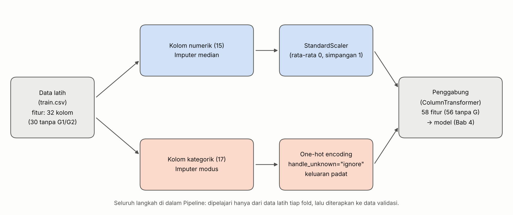

# Bab 3. Praproses

## 3.1 Temuan kualitas data

Pemeriksaan hanya memakai data latih (316 baris, 34 kolom).

- **Nilai hilang: 0** dan **baris duplikat: 0** (dihitung, bukan diasumsikan).
- **Jenis kolom:** dari 32 fitur, 15 numerik (termasuk atribut ordinal berkode angka seperti `Medu`, `studytime`, dan `famrel`) dan 17 kategorik (teks).
- **Pencilan pada `absences`.** Fitur ini sangat condong ke kanan: median 4, rata-rata 5,70, nilai tertinggi 75, skewness 3,45. Dengan aturan IQR (batas atas 20), terdapat 12 siswa di atas batas. Tidak ada indikasi bahwa nilai-nilai ini salah input, tetapi hal itu tidak dapat dipastikan dari data.
- **Kategori jarang** (kurang dari 10% data): `Mjob` = health (26 siswa), `Fjob` = teacher (22), health (18), at_home (13), `reason` = other (29), `guardian` = other (25), dan `higher` = no (18 siswa, 5,7%).
- **Proporsi kelas target:** 212 siswa lulus (67,1%) dan 104 tidak lulus (32,9%), sehingga ketidakseimbangannya sedang (Bab 2).

## 3.2 Keputusan praproses

**Tabel 3.1 Keputusan praproses**

| Langkah | Keputusan | Alasan |
|---|---|---|
| Nilai hilang | `SimpleImputer`: median untuk numerik, modus untuk kategorik | Data latih tidak memiliki nilai hilang, tetapi imputer tetap dipasang agar pipeline aman bila data baru memuat nilai kosong. Median tahan terhadap nilai ekstrem. |
| Fitur kategorik nominal | One-hot encoding (`OneHotEncoder`, `handle_unknown='ignore'`, keluaran padat) | Label encoding memberi urutan palsu pada kategori yang tidak berurutan dan dapat menyesatkan kNN dan SVM. `handle_unknown='ignore'` mencegah error saat ada kategori yang hanya muncul di fold lain atau di data baru. Keluaran padat diperlukan karena Naive Bayes Gaussian tidak menerima matriks sparse. |
| Fitur numerik | `StandardScaler` (rata-rata 0, simpangan baku 1) | Wajib bagi SVM dan kNN yang berbasis jarak dan peka terhadap skala; tidak merugikan model pohon. |
| Atribut ordinal berkode angka | Diperlakukan sebagai numerik (keputusan dari tahap data, Bab 2) | Urutan nilainya bermakna, dan one-hot akan menambah banyak kolom pada data yang kecil. |
| Pencilan `absences` | Dibiarkan, tidak dipotong dan tidak ditransformasi | Nilai ketidakhadiran tinggi merupakan sinyal perilaku nyata dari siswa yang berisiko (bukan kesalahan pencatatan). Model berbasis pohon kebal terhadap skala pencilan, sedangkan pemotongan (*clipping*) berisiko mereduksi varians informasi kritis. Konsekuensi pada model sensitif jarak (kNN, SVM) dicatat sebagai keterbatasan metodologis. |
| Ketidakseimbangan kelas | `class_weight='balanced'` pada model yang mendukungnya (Bab 4), bukan resampling | Data kecil (316 baris); membuat data sintetis seperti SMOTE (Chawla dkk., 2002) pada data sekecil ini berisiko menambah derau, dan cara ini juga lebih sederhana. Naive Bayes dan kNN tidak punya opsi pembobotan kelas. |
| Seleksi fitur | Tidak dilakukan | Tidak wajib; jumlah fitur masih wajar, dan seleksi yang belajar dari data harus berada di dalam pipeline sehingga ditunda. |
| Dua skenario fitur | Fungsi `build_preprocessor(fitur, num_cols, cat_cols)` menerima daftar fitur | Satu fungsi yang sama dipakai untuk skenario dengan dan tanpa G1/G2; kolom yang tidak ada di daftar fitur otomatis disaring. |

**Jumlah fitur setelah praproses.** Skenario dengan G1/G2: 32 kolom asli menjadi **58 fitur**. Skenario tanpa G1/G2: 30 kolom asli menjadi **56 fitur**.

## 3.3 Alur pipeline

*Gambar 3.1. Alur pipeline praproses. Seluruh langkah berada di dalam `Pipeline` sehingga hanya dipelajari dari data latih tiap fold.*

Data latih dibagi dua jalur: kolom numerik melewati imputer median lalu `StandardScaler`, sedangkan kolom kategorik melewati imputer modus lalu one-hot encoding. Keduanya digabung oleh `ColumnTransformer`, lalu diteruskan ke model (Bab 4).

## 3.4 Pencegahan kebocoran data

**Kebocoran data** terjadi ketika informasi dari data yang seharusnya tidak diketahui (data validasi atau uji) ikut dipakai saat pelatihan (Kaufman dkk., 2012). Pada praproses, contohnya adalah menghitung rata-rata dan simpangan baku untuk standardisasi dari seluruh data sebelum validasi silang. Pembagian data jadi sudah tidak murni, sebab fold validasi ikut memengaruhi nilai yang dipakai untuk melatih. Skor yang dilaporkan menjadi terlalu optimis.

Pencegahannya adalah memasukkan seluruh langkah praproses ke dalam `Pipeline`, sehingga `scikit-learn` men-*fit* tiap langkah hanya pada data latih di tiap fold lalu menerapkannya ke data validasi (Pedregosa dkk., 2011).

**Demonstrasi.** Kami membandingkan dua cara pada validasi silang yang sama (5-fold dengan 3 ulangan, `random_state=42`): (1) praproses di-*fit* pada seluruh data latih lalu validasi silang dijalankan pada data hasil olahan, dan (2) praproses berada di dalam pipeline.

**Tabel 3.2 F1 kelas tidak lulus: praproses di luar dan di dalam pipeline**

| Skenario | Model | Di luar pipeline | Di dalam pipeline | Selisih |
|---|---|---|---|---|
| Dengan G1/G2 | kNN (k=5) | 0,6601 | 0,6429 | +0,0172 |
| Dengan G1/G2 | SVM (RBF) | 0,8348 | 0,8314 | +0,0034 |
| Dengan G1/G2 | Decision Tree (kedalaman 3) | 0,8631 | 0,8631 | 0,0000 |
| Tanpa G1/G2 | kNN (k=5) | 0,3182 | 0,3194 | −0,0012 |
| Tanpa G1/G2 | SVM (RBF) | 0,4428 | 0,4454 | −0,0027 |
| Tanpa G1/G2 | Decision Tree (kedalaman 3) | 0,4151 | 0,4151 | 0,0000 |

Cara (1) menghasilkan skor sedikit lebih tinggi hanya pada skenario dengan G1/G2 untuk kNN (+0,017) dan SVM (+0,003); pada skenario tanpa G1/G2 selisihnya bahkan sedikit negatif, dan pada Decision Tree selisihnya nol. Arah ini sesuai dengan dugaan bahwa kebocoran standardisasi lebih terasa pada model berbasis jarak, sedangkan pohon tidak berubah karena tidak peka terhadap skala. Namun selisihnya kecil dan masih dalam rentang variasi antarfold (pada Bab 4, simpangan baku F1 antarfold berkisar sekitar 0,03 sampai 0,10), sehingga kami **tidak** menyimpulkan bahwa kebocoran di data ini besar. Yang kami tegaskan adalah **prinsipnya**: pada data kecil dampaknya mungkin kecil, tetapi praproses yang lebih agresif (seleksi fitur atau resampling) dapat menimbulkan selisih besar, sehingga pipeline tetap menjadi cara yang aman.

Dalam penerapan, `handle_unknown='ignore'` juga menjawab pertanyaan "bagaimana bila ada kategori baru di data uji": kategori itu diberi nilai 0 pada semua kolom one-hot milik fitur tersebut, sehingga tidak terjadi error.

## Daftar sumber untuk bab ini

- Chawla, N. V., Bowyer, K. W., Hall, L. O., & Kegelmeyer, W. P. (2002). SMOTE: Synthetic minority over-sampling technique. *Journal of Artificial Intelligence Research, 16*, 321–357.
- Kaufman, S., Rosset, S., Perlich, C., & Stitelman, O. (2012). Leakage in data mining: Formulation, detection, and avoidance. *ACM Transactions on Knowledge Discovery from Data, 6*(4), Article 15.
- Pedregosa, F. dkk. (2011). Scikit-learn: Machine learning in Python. *Journal of Machine Learning Research, 12*, 2825–2830. Dokumentasi scikit-learn (versi 1.9.1), bagian *Pipelines and composite estimators* dan *Common pitfalls and recommended practices*.
- Cortez, P., & Silva, A. (2008). Using data mining to predict secondary school student performance. *Proceedings of FUBUTEC 2008*, 5–12.
