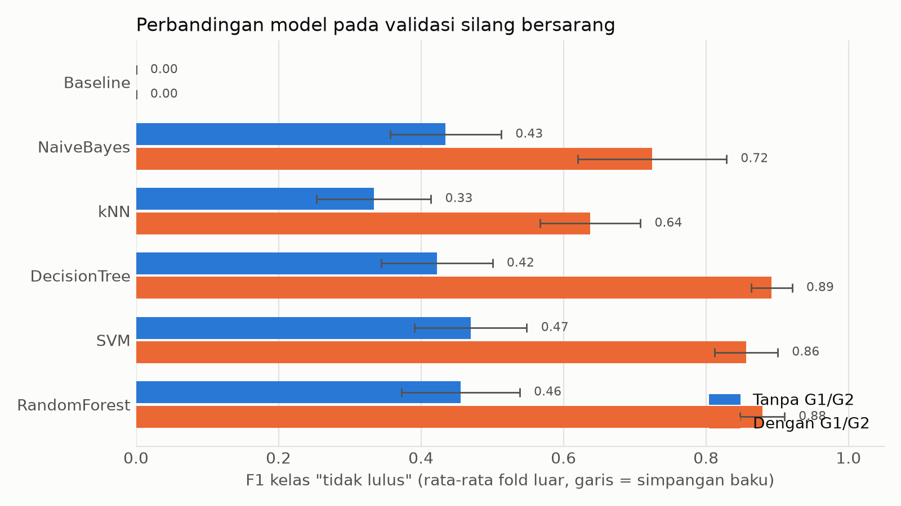
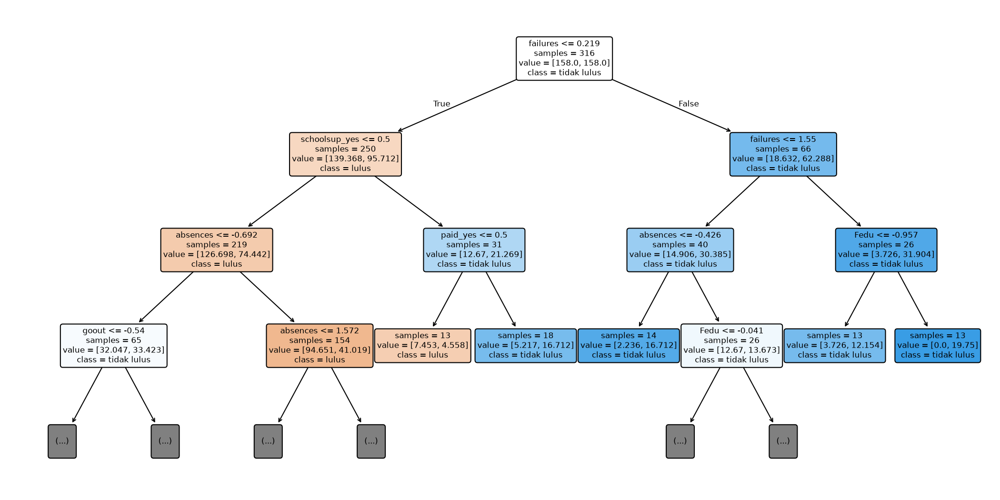

# Bab 4. Model dan Pelatihan

## 4.1 Model yang dilatih

Kami melatih lima model dari materi Pertemuan 3 sampai 7 dan satu baseline sebagai pembanding. Model dipilih karena mewakili keluarga algoritma yang berbeda, sehingga perbandingannya informatif.

| Model | Pertemuan | Alasan dipilih | Asumsi dan kelemahan utama |
|---|---|---|---|
| Baseline (selalu menebak kelas mayoritas) | — | Pembanding wajib. Model yang tidak mengalahkan baseline tidak berguna. | Tidak belajar apa pun; tidak pernah menandai siswa berisiko. |
| Decision Tree | 3 | Mudah dijelaskan; aturan keputusannya dapat dibaca (Breiman dkk., 1984). | Pohon yang dalam mudah overfitting dan tidak stabil terhadap perubahan data kecil. |
| Random Forest | 4 | Ensembel bagging; rata-rata banyak pohon membuat hasil lebih stabil dan mengurangi varians (Breiman, 2001). | Kurang mudah ditafsirkan dibanding satu pohon; lebih lama dilatih. |
| Naive Bayes (Gaussian) | 6 | Cepat dan sederhana; cocok sebagai pembanding model probabilistik. | Mengasumsikan fitur saling bebas kondisional dan berdistribusi normal. Asumsi ini terlanggar berat di data ini: Bab 2 menunjukkan korelasi kuat antara G1 dan G2 (r = 0,85) yang melanggar independensi, serta 17 variabel kategorik hasil one-hot encoding yang menghasilkan sebaran biner, bukan Gaussian. |
| SVM | 6 | Mencari batas pemisah dengan margin terbesar; punya kernel untuk batas melengkung (Cortes dan Vapnik, 1995). | Sensitif terhadap skala fitur (sudah ditangani pipeline) dan terhadap pilihan C dan gamma; sulit ditafsirkan. |
| kNN | 7 | Lazy learning: tidak ada fase pelatihan, keputusan dari tetangga terdekat (Cover dan Hart, 1967). | Sensitif terhadap skala dan fitur tak relevan; fitur one-hot menambah dimensi sehingga jarak kurang bermakna. |

Ketidakseimbangan kelas ditangani dengan `class_weight='balanced'` pada Decision Tree, Random Forest, dan SVM. Langkah ini krusial karena proporsi kelas minoritas "tidak lulus" hanya 32,9% (104 siswa) berbanding 67,1% (212 siswa) kelas lulus (Bab 2). Model tanpa pembobotan berisiko bias memprediksi kelas mayoritas demi mengejar akurasi semu; ketiadaan opsi pembobotan ini pada Naive Bayes dan kNN menjadi kelemahan bawaan kedua model tersebut.

## 4.2 Ruang pencarian hiperparameter

Hiperparameter disetel dengan grid search. Rentang di bawah ini adalah titik awal yang masuk akal untuk data berukuran kecil.

| Model | Hiperparameter dan nilai yang dicoba | Alasan rentang |
|---|---|---|
| Decision Tree | `max_depth` ∈ {2, 3, 4, 5, tanpa batas}; `min_samples_leaf` ∈ {1, 5, 10}; `ccp_alpha` ∈ {0, 0,005, 0,01, 0,02} | Membatasi kedalaman dan memangkas cabang (cost-complexity pruning) mencegah pohon menghafal data latih. Daun yang minimal berisi beberapa siswa mencegah aturan yang hanya berlaku untuk satu-dua siswa. |
| Random Forest | `n_estimators` ∈ {200, 500}; `max_depth` ∈ {tanpa batas, 5, 10}; `min_samples_leaf` ∈ {1, 3, 5} | Lebih banyak pohon membuat rata-rata lebih stabil, namun manfaatnya menurun di atas sekitar 500. Kedalaman dan ukuran daun mengendalikan kerumitan tiap pohon. |
| Naive Bayes | `var_smoothing` ∈ {1e-9, 1e-6, 1e-3, 1e-1} | Menambah varians kecil supaya tidak ada varians nol, yang sering terjadi pada fitur one-hot. Nilai besar membuat model lebih "halus". |
| SVM | Kernel RBF: `C` ∈ {0,1; 1; 10}, `gamma` ∈ {scale, 0,01, 0,1}. Kernel linear: `C` ∈ {0,1; 1; 10} | C kecil memberi margin lebar yang toleran terhadap kesalahan (bias tinggi); C besar memberi margin sempit yang ketat (risiko overfitting). Gamma besar membuat pengaruh tiap titik sempit sehingga batas berkelok-kelok. Gamma hanya relevan untuk RBF, jadi kernel linear dicoba terpisah. |
| kNN | `n_neighbors` ∈ {3, 5, 7, 11, 15}; `weights` ∈ {uniform, distance} | k kecil berarti varians tinggi (mengikuti noise); k besar berarti bias tinggi (terlalu halus), yaitu pertukaran bias-varians. Pembobotan jarak membuat tetangga dekat lebih berpengaruh. |

## 4.3 Prosedur penyetelan dan penilaian

Jika penyetelan hiperparameter dan penilaian performa memakai data yang sama, skor yang dilaporkan menjadi terlalu optimis, karena hiperparameter sudah "menyesuaikan diri" dengan data penilaian (Cawley dan Talbot, 2010; Varma dan Simon, 2006). Untuk menghindarinya kami memakai **validasi silang bersarang**:

- **Lingkaran luar** (penilaian): 5-fold stratified, diulang 3 kali dengan `random_state=42`, sehingga ada 15 fold luar. Pembagian fold dibuat satu kali dan dipakai ulang untuk semua model dan kedua skenario, sehingga perbandingan antarmodel dapat dilakukan berpasangan fold demi fold.
- **Lingkaran dalam** (penyetelan): 3-fold stratified di dalam data latih tiap fold luar. Hiperparameter terbaik dipilih dari lingkaran ini saja; fold luar tidak pernah dipakai untuk memilih hiperparameter.
- **Metrik penyetelan**: F1 untuk kelas positif (tidak lulus). Tujuan kami menangkap siswa berisiko, dan F1 menyeimbangkan recall (siswa berisiko yang tertangkap) dengan precision (ketepatan penandaan). Akurasi tidak dipakai karena menyesatkan pada data yang tidak seimbang.
- **Metrik yang dilaporkan**: F1, recall, precision, dan ROC-AUC untuk kelas tidak lulus, per fold.
- **Semua praproses di dalam pipeline** (imputasi, one-hot, standardisasi) sehingga hanya dipelajari dari data latih tiap fold (lihat Bab 3).
- **Data uji tidak disentuh** pada tahap ini; seluruh pelatihan dan penyetelan hanya memakai `train.csv`.

Model final untuk tiap model dan skenario dilatih ulang pada seluruh data latih, dengan hiperparameter dicari memakai grid search 5-fold. Model final inilah yang disimpan (`results/models/*.joblib`) dan diserahkan ke tahap evaluasi.

Dua skenario fitur dibandingkan: **dengan G1/G2** (nilai periode pertama dan kedua tersedia) dan **tanpa G1/G2** (skenario peringatan dini yang lebih realistis).

## 4.4 Hasil validasi silang bersarang

Tabel berikut menampilkan rata-rata dan simpangan baku dari 15 fold luar. Selang kepercayaan dan uji perbandingan berpasangan antarmodel disajikan di Bab 5 dan 6.

**Tabel 4.1 Skenario dengan G1/G2 (rata-rata ± simpangan baku)**

| Model | F1 | Recall | Precision | ROC-AUC |
|---|---|---|---|---|
| Baseline | 0,000 ± 0,000 | 0,000 ± 0,000 | 0,000 ± 0,000 | 0,500 ± 0,000 |
| Decision Tree | 0,892 ± 0,029 | 0,952 ± 0,044 | 0,841 ± 0,045 | 0,957 ± 0,020 |
| Random Forest | 0,879 ± 0,031 | 0,939 ± 0,049 | 0,828 ± 0,049 | 0,964 ± 0,016 |
| SVM | 0,856 ± 0,044 | 0,933 ± 0,058 | 0,796 ± 0,065 | 0,965 ± 0,021 |
| Naive Bayes | 0,724 ± 0,105 | 0,702 ± 0,144 | 0,765 ± 0,091 | 0,916 ± 0,041 |
| kNN | 0,638 ± 0,070 | 0,546 ± 0,086 | 0,782 ± 0,097 | 0,865 ± 0,052 |

**Tabel 4.2 Skenario tanpa G1/G2 (rata-rata ± simpangan baku)**

| Model | F1 | Recall | Precision | ROC-AUC |
|---|---|---|---|---|
| Baseline | 0,000 ± 0,000 | 0,000 ± 0,000 | 0,000 ± 0,000 | 0,500 ± 0,000 |
| SVM | 0,470 ± 0,079 | 0,543 ± 0,157 | 0,426 ± 0,052 | 0,643 ± 0,064 |
| Random Forest | 0,455 ± 0,083 | 0,446 ± 0,117 | 0,482 ± 0,091 | 0,670 ± 0,064 |
| Naive Bayes | 0,435 ± 0,078 | 0,394 ± 0,080 | 0,503 ± 0,116 | 0,663 ± 0,071 |
| Decision Tree | 0,422 ± 0,078 | 0,414 ± 0,103 | 0,453 ± 0,114 | 0,599 ± 0,074 |
| kNN | 0,334 ± 0,080 | 0,273 ± 0,079 | 0,441 ± 0,099 | 0,591 ± 0,045 |

*Gambar 4.1. F1 kelas "tidak lulus" per model (rata-rata fold luar; garis menunjukkan simpangan baku).*

Beberapa hal yang dapat dibaca dari hasil ini:

1. **Semua model mengalahkan baseline.** Baseline selalu menebak "lulus", sehingga F1 dan recall kelas tidak lulus bernilai nol dan ROC-AUC 0,5 (setara tebak acak).
2. **G1 dan G2 sangat menaikkan performa.** Pada skenario dengan G1/G2, F1 terbaik mencapai sekitar 0,89, sedangkan tanpa keduanya semua model berada di sekitar 0,33 sampai 0,47. Ini wajar karena G1 dan G2 adalah nilai periode sebelumnya yang sangat dekat dengan nilai akhir G3 yang menentukan target.
3. **Tanpa G1/G2, prediksi masih lemah.** ROC-AUC terbaik sekitar 0,67, hanya sedikit di atas tebak acak (0,5). Artinya fitur latar belakang dan perilaku saja belum cukup untuk memisahkan siswa yang lulus dan tidak lulus dengan baik.
4. **Selisih antarmodel di papan atas kecil dibanding simpangan baku.** Misalnya pada skenario dengan G1/G2, selisih F1 Decision Tree dan Random Forest (0,013) jauh lebih kecil daripada simpangan baku masing-masing (sekitar 0,03). Karena itu urutan model di tabel **belum** membuktikan satu model lebih baik; pengujiannya dilakukan pada Bab 5 dan 6 dengan perbandingan berpasangan.
5. **Model berbasis jarak paling lemah.** kNN terendah pada kedua skenario (F1 0,638 pada dengan_G dan 0,334 pada tanpa_G). Hal ini terjadi karena fenomena kutukan dimensi (*curse of dimensionality*): enkoding one-hot menghasilkan 58 dan 56 dimensi pada sampel data latih yang kecil (316 baris), sehingga jarak Euclidean antartitik data menjadi seragam dan kehilangan diskriminasi lokal. Selain itu, kNN tidak mendukung pembobotan kelas (*class weight*).
6. **Simpangan baku besar.** Dengan data latih yang kecil, skor antarfold bervariasi cukup lebar, terutama pada skenario tanpa G1/G2 (sekitar 0,08).

## 4.5 Hiperparameter terbaik

Hiperparameter terbaik hasil penyetelan pada seluruh data latih (`results/best_params.json`):

| Model | Dengan G1/G2 | Tanpa G1/G2 |
|---|---|---|
| Decision Tree | `max_depth`=2, `min_samples_leaf`=1, `ccp_alpha`=0 | `max_depth`=4, `min_samples_leaf`=10, `ccp_alpha`=0 |
| Random Forest | `n_estimators`=200, `max_depth`=tanpa batas, `min_samples_leaf`=1 | `n_estimators`=200, `max_depth`=tanpa batas, `min_samples_leaf`=1 |
| Naive Bayes | `var_smoothing`=0,1 | `var_smoothing`=1e-9 |
| SVM | kernel linear, `C`=0,1 | kernel linear, `C`=10 |
| kNN | `n_neighbors`=7, `weights`=uniform | `n_neighbors`=5, `weights`=uniform |

Beberapa catatan:

- Pada skenario dengan G1/G2, pohon terbaik hanya sedalam 2. Ini konsisten dengan pentingnya fitur di bawah: satu fitur (G2) hampir menentukan semuanya, sehingga pohon yang lebih dalam tidak diperlukan.
- Tanpa G1/G2, pohon memilih `min_samples_leaf`=10, yaitu daun yang lebih besar. Ini menandakan data yang berisik dan kecil sehingga model yang lebih sederhana lebih aman dari overfitting.
- SVM memilih kernel **linear** pada kedua skenario, artinya batas lengkung (RBF) tidak memberi keuntungan pada data ini.
- Nilai `var_smoothing` Naive Bayes sangat berbeda antarskenario (0,1 pada skenario dengan_G dan 1e-9 pada skenario tanpa_G). Perbedaan ini mencerminkan kebutuhan regularisasi varians: pada skenario dengan_G, nilai 0,1 menambahkan varians artifisial yang lebih besar guna meredam dominasi korelasi ekstrem antara G1 dan G2, sedangkan pada skenario tanpa_G, data didominasi fitur one-hot biner tanpa ada fitur numerik yang luar biasa dominan sehingga nilai default 1e-9 dipilih oleh penyetelan.

## 4.6 Pentingnya fitur

Pentingnya fitur (impurity-based `feature_importances_`) dari Decision Tree dan Random Forest, lima teratas:

| Skenario | Model | Lima fitur teratas (nilai) |
|---|---|---|
| Dengan G1/G2 | Decision Tree | G2 (0,979), G1 (0,021), lainnya 0 |
| Dengan G1/G2 | Random Forest | G2 (0,311), G1 (0,226), absences (0,032), failures (0,030), goout (0,024) |
| Tanpa G1/G2 | Decision Tree | failures (0,401), absences (0,257), Fedu (0,109), goout (0,096), schoolsup_yes (0,086) |
| Tanpa G1/G2 | Random Forest | absences (0,073), failures (0,058), goout (0,050), age (0,045), health (0,038) |

- Dengan G1/G2, G2 mendominasi. Model pada dasarnya hanya "melihat nilai periode kedua".
- Tanpa G1/G2, `failures` (jumlah kegagalan sebelumnya) dan `absences` (jumlah ketidakhadiran) konsisten muncul di kedua model, sehingga keduanya kandidat penanda risiko.
- Nilai importance Random Forest tersebar merata (tertinggi hanya 0,073), menandakan tidak ada satu fitur yang menonjol.
- Perlu hati-hati: importance berbasis impurity cenderung menguntungkan fitur numerik atau bernilai banyak seperti `absences` (Strobl dkk., 2007), dan ia menunjukkan fitur yang dipakai model, **bukan** sebab-akibat.

*Gambar 4.2. Pohon keputusan skenario tanpa G1/G2, ditampilkan sampai kedalaman 3.*

## 4.7 Keterbatasan bagian ini

- Grid hiperparameter berukuran kecil sehingga mungkin belum menemukan setelan optimal.
- Data latih kecil sehingga skor antarfold bervariasi lebar.
- Naive Bayes dan kNN tidak mendukung pembobotan kelas.

## Daftar sumber untuk bab ini

- Breiman, L. (2001). Random forests. *Machine Learning, 45*(1), 5–32.
- Breiman, L., Friedman, J. H., Olshen, R. A., & Stone, C. J. (1984). *Classification and Regression Trees*. Wadsworth.
- Cawley, G. C., & Talbot, N. L. C. (2010). On over-fitting in model selection and subsequent selection bias in performance evaluation. *Journal of Machine Learning Research, 11*, 2079–2107.
- Cortes, C., & Vapnik, V. (1995). Support-vector networks. *Machine Learning, 20*(3), 273–297.
- Cortez, P., & Silva, A. (2008). Using data mining to predict secondary school student performance. *Proceedings of FUBUTEC 2008*, 5–12. (Dataset: UCI Machine Learning Repository, Student Performance.)
- Cover, T., & Hart, P. (1967). Nearest neighbor pattern classification. *IEEE Transactions on Information Theory, 13*(1), 21–27.
- Pedregosa, F. dkk. (2011). Scikit-learn: Machine learning in Python. *Journal of Machine Learning Research, 12*, 2825–2830. (Dokumentasi scikit-learn versi 1.9.1.)
- Strobl, C., Boulesteix, A.-L., Zeileis, A., & Hothorn, T. (2007). Bias in random forest variable importance measures. *BMC Bioinformatics, 8*, 25.
- Varma, S., & Simon, R. (2006). Bias in error estimation when using cross-validation for model selection. *BMC Bioinformatics, 7*, 91.

